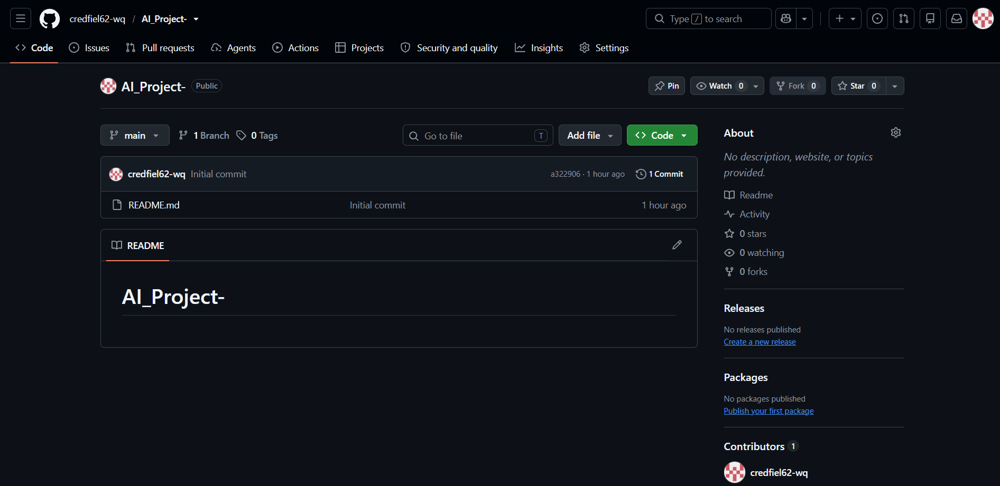
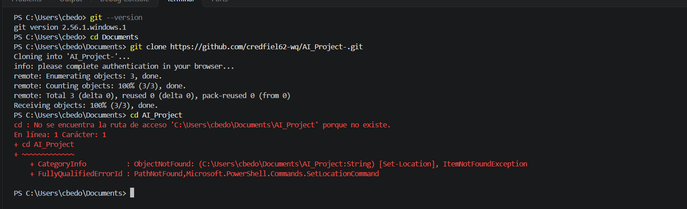
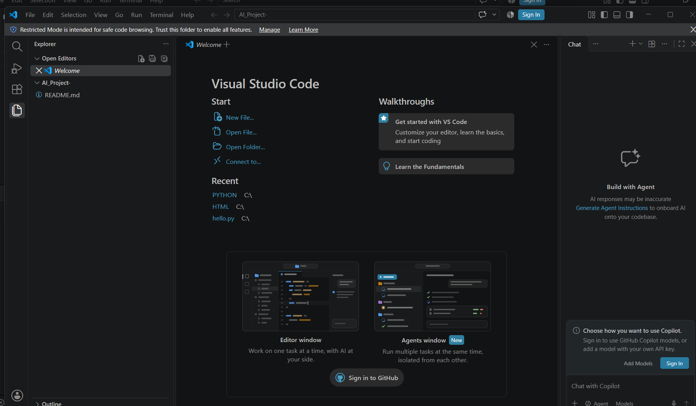
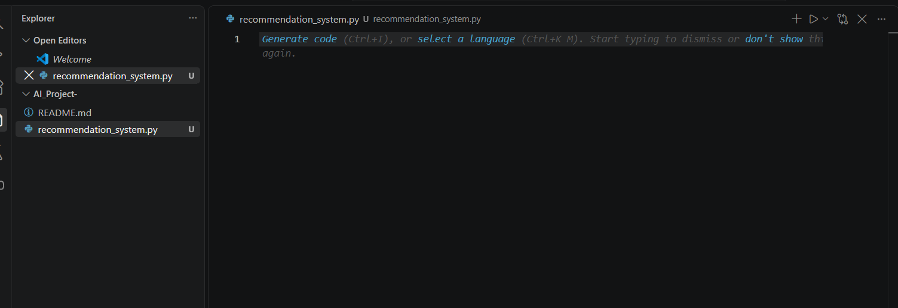
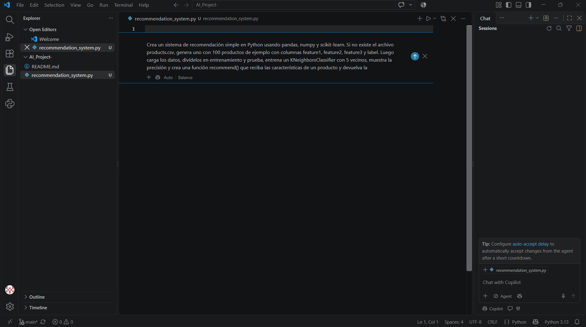
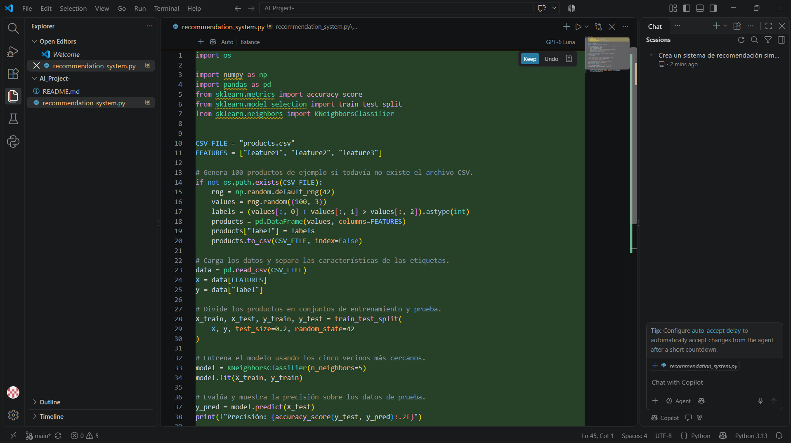
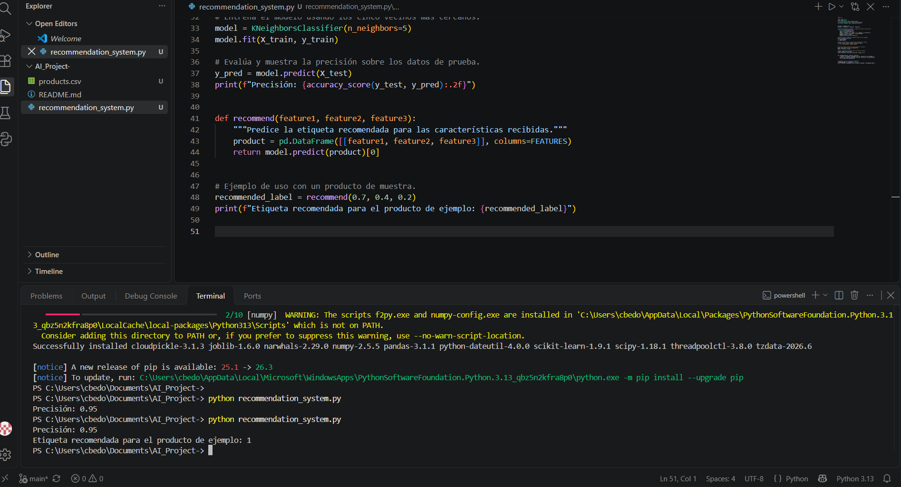
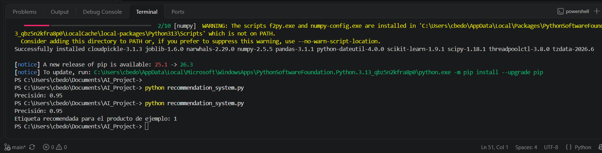

# AI_Project- · Sistema de recomendación con GitHub Copilot

**Actividad formativa:** GitHub Copilot
**Autor:** [Carlos Bedoya]

## Descripción
Este proyecto implementa un sistema de recomendación simple en Python, generado con ayuda de **GitHub Copilot** en Visual Studio Code. El sistema usa el algoritmo **K-vecinos más cercanos (KNN)** de scikit-learn para predecir la etiqueta de un producto a partir de tres características.

## Herramientas utilizadas
- GitHub (repositorio remoto)
- Visual Studio Code
- GitHub Copilot (plan gratuito)
- Git 2.56
- Python 3.13 con pandas, numpy y scikit-learn

---

## Paso a paso

### 1. Creación del repositorio en GitHub
Se creó una cuenta en GitHub y un nuevo repositorio llamado **AI_Project-**, con un archivo README.



### 2. Clonar el repositorio en el computador
Desde la terminal integrada de VS Code (**Terminal → New Terminal**) se ejecutaron los siguientes comandos:

```
cd Documents
git clone https://github.com/credfiel62-wq/AI_Project-.git
cd AI_Project-
```

> Nota: al principio la terminal no reconocía el comando `git`, por lo que fue necesario instalar Git desde git-scm.com y reiniciar VS Code.



### 3. Abrir el proyecto en VS Code
La carpeta se abrió con **File → Open Folder…**, se marcó como confiable (**Trust**) y se inició sesión en GitHub Copilot.



### 4. Crear el archivo de código
Se creó el archivo `recommendation_system.py` con clic derecho en la carpeta → **New File…**



### 5. Generar el código con GitHub Copilot
Con **Ctrl + I** se abrió Copilot dentro del archivo y se le dio la siguiente instrucción:

> Crea un sistema de recomendación simple en Python usando pandas, numpy y scikit-learn. Si no existe el archivo products.csv, genera uno con 100 productos de ejemplo con columnas feature1, feature2, feature3 y label. Luego carga los datos, divídelos en entrenamiento y prueba, entrena un KNeighborsClassifier con 5 vecinos, muestra la precisión y crea una función recommend() que reciba las características de un producto y devuelva la recomendación. Agrega comentarios en español.



Copilot generó el código y se aceptó con **Keep**. Después se le pidió una segunda instrucción para agregar un ejemplo de uso de la función `recommend()`.




**Qué hace el código:**
1. Si no existe `products.csv`, genera 100 productos con tres características aleatorias. La etiqueta es 1 cuando feature1 + feature2 es mayor que feature3, y 0 en caso contrario.
2. Carga los datos y separa las características (X) de la etiqueta (y).
3. Divide los datos: 80% para entrenamiento y 20% para prueba.
4. Entrena un modelo KNN con 5 vecinos.
5. Evalúa el modelo y muestra su precisión.
6. La función `recommend()` recibe las tres características de un producto y devuelve la etiqueta que predice el modelo.

### 6. Instalar librerías y ejecutar
```
pip install pandas numpy scikit-learn
python recommendation_system.py
```

**Resultado obtenido:**
```
Precisión: 0.95
Etiqueta recomendada para el producto de ejemplo: 1
```
El modelo acierta el 95% de las veces con los datos de prueba.



### 7. Subir los cambios a GitHub